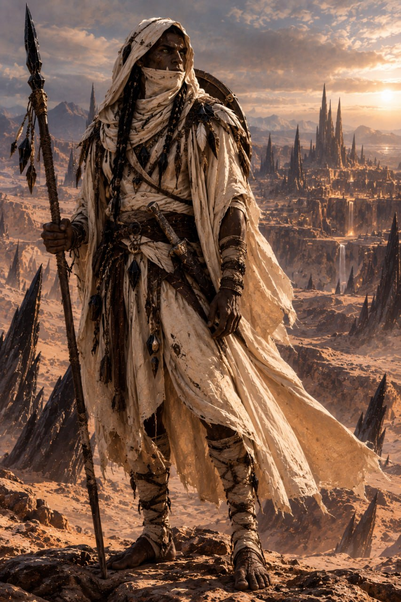

# Alzum

Alzum Al-Musafir Zar-Jad est un grand orc **Naas-Al-Kharash**, fier habitant d'[Al-Zujahr](../../lieux/nassahr/balasham/al-zujahr.md), cité-sanctuaire du [Nassahr](../../lore/geographie/nassahr.md).

## Quête

Les raisons du départ d'Alzum de ses terres natales restent encore mystérieuses, mais ce dernier semble démontrer un grand intérêt vis-à-vis des plans élémentaires.

## Apparence

**Stature :** Grand colosse élancé mesurant environ **2m10**, à la silhouette particulièrement sèche, fine et musclée pour un orque. Son corps ne porte aucune graisse inutile, optimisé pour l'endurance et l'escalade dans le désert rocailleux.

**Peau & Visage :** Un épiderme basané très sombre, couleur de terre brûlée, parcouru de quelques scarifications minérales d'initiation. Deux crocs d'orque acérés pointent fièrement de sa mâchoire inférieure.

**Regard d'Émeraude :**  Ses yeux arborent une couleur vert foncé profond, vitreuse et perçante, identique aux éclats d'émeraude brute nichés dans les profondeurs de l'obsidienne. Ce regard singulier, doté de la membrane nictitante transparente du désert, lui a valu son prénom dès la naissance.

**Chevelure :** De longs cheveux noirs de jais tressés en plusieurs nattes serrées, ornées de petites perles d'obsidienne polie et de fils de lin.

**Vêtements & Drapés :**

- Un grand manteau-toge en tissu clair et fluide couleur sable écru, créant un contraste saisissant avec sa peau très sombre et le protégeant de l'ardeur du soleil.
- Une grande capuche et un foulard protecteur (*Litham*) qu'il remonte jusqu'au nez pour filtrer les bourrasques de poussière et le sable abrasif (*rami*).
- Sous son drapé : une tunique sobre et respirante en cuir souple et coton léger.
- Pieds nus et griffus : selon la tradition de son peuple, il ne porte pas de bottes rigides afin de conserver une adhérence maximale sur les arêtes de roche. De solides bandes de tissu entourent ses pieds et remontent le long de ses chevilles jusqu'à ses mollets.

**Ornements & Équipement :**

- Plusieurs gri-gris chamaniques, amulettes de verre volcanique noir et plumes d'oiseaux du désert sertis sur ses épaules et à sa ceinture.
- Un solide bouclier en acier poli porté dans le dos.
- Une longue lance de chasseur du désert, équilibrée pour la garde et l'estoc, avec une pointe taillée dans une obsidienne renforcée.
- Une dague de voyage à la ceinture

## Détails

| Détail       | Réponse                       |
| ------------ | ----------------------------- |
| Couleur      | Emeraude                      |
| Anniversaire | 6 de la Deuxième Lune, 236 AA |

