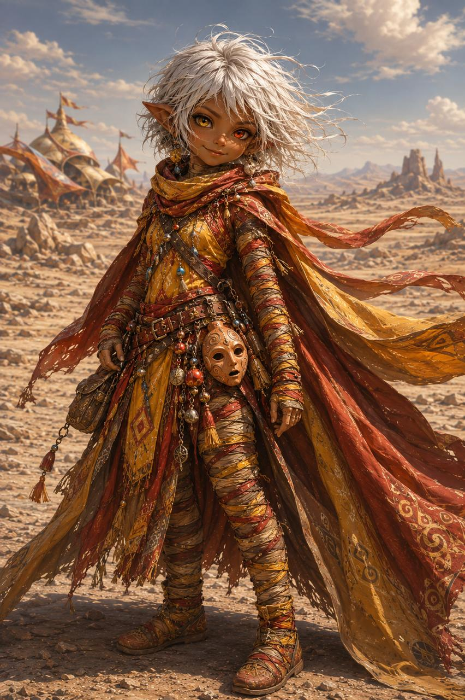
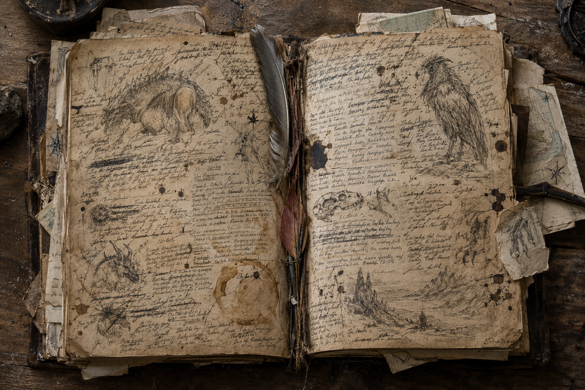

# Corvenna

Covenna Amberlyne est une jeune gnome de la province de [Kuniyama](../../lieux/yu-feng/xin-mishu/kuniyama/kuniyama.md), une région montagneuse située dans le [Yu Feng](../../lore/geographie/yu-feng.md), à la frontière du [Nassahr](../../lore/geographie/nassahr.md). Elle est accompagnée de Reflet, un serpent à dos-de-verre aux écailles transparentes.

## Quête

Corvenna porte un carnet légué par son mentor, **Barnabe**. Certaines de ses pages portent l'écriture mystérieuse que l'on retrouve sur la pierre de [Shin](../shin/shin.md) et dans le message de [Nataniel](../nataniel/nataniel.md).

## Apparence

De petite taille, comme toute gnome. Ses cheveux mi-courts sont d'un blanc pur, et ses yeux verons, jaune et rouge, lui donnent un regard singulier. Sa peau est striée de fines marques laissées par le vent.

Sa tenue est fidèle aux coutumes de Kuniyama : des habits drapés, jaunes et rouges, flottant au vent, et des bandelettes couvrant son corps. À sa ceinture pend un **masque de pierre**, ordinairement réservé aux rites des tribus. 

## Détails

| Détail       | Réponse                        |
| ------------ | ------------------------------ |
| Anniversaire | 15 de la Deuxième Lune, 233 AA |
| Couleur      | Rouge                          |

