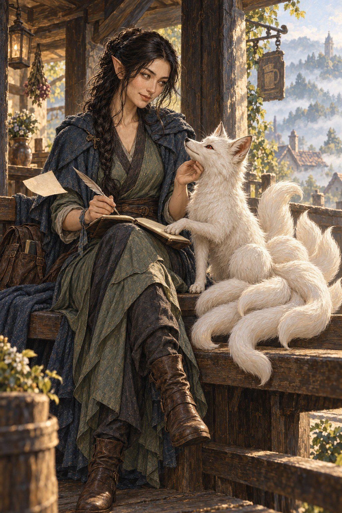

# Miyara

Miyara Vardelis est une elfe originaire de [Treskaï](../../lieux/verteris/traverse/catenaris/treskai/treskai.md), dans la province de [Caténaris](../../lieux/verteris/traverse/catenaris/catenaris.md), au royaume de [Traverse](../../lieux/verteris/traverse/traverse.md), à l'est de [Verteris](../../lore/geographie/verteris.md). Elle a grandi bercée par les traditions de ses racines [yu-fengiennes](../../lore/geographie/yu-feng.md). Elle est accompagnée de Rikka, son jeune renard blanc à neuf queues.

## Quête

Miyara a quitté Treskaï pour retrouver les traces de ses ancêtres et mieux comprendre leur migration durant l’Âge des Ruines. Elle cherche ce qui subsiste de leur passage dans les lieux et les récits rencontrés en chemin. Elle espère également profiter de ce voyage pour en apprendre davantage sur Rikka.

## Apparence

L'elfe d'une trentaine d'année est grande et élancée. Elle a la peau d'ivoire, les yeux gris-vert et de longs cheveux noirs qu'elle rassemble habituellement en une tresse basse. Ses oreilles effilées s'inclinent légèrement vers l'arrière. Son visage est expressif: un sourcil relevé ou un sourire retenu annonce souvent une plaisanterie.

Ses vêtements conservent une influence yufengienne adaptée au quotidien de Treskaï: robe vert grisé à pans croisés, pantalon souple, bottines brunes et manteau bleu d'ardoise. Des attaches permettent de retenir les pans lorsque le vent se lève. Une courte inscription en Xiezufen se trouve à l'intérieur d'un revers de manche; une bénédiction qui se traduit comme suit : ***Que demeure en toi le souffle, quand se lèveront les vents contraires.***

## Famille

La famille de Miyara tient à Treskaï un temple où l’on honore deux Gardiens, un renard géant et un loup géant.

Son frère a consacré sa vie à l’étude de ces Gardiens, en remontant les traces laissées par leurs ancêtres lors de leur migration durant l’Âge des Ruines. Il a confié à Miyara le carnet qui rassemble toutes ses recherches.

## Détails

| Détail | Réponse |
| --- | --- |
| Anniversaire | 4 de la Semaine de Transition, 232 AA |
| Couleur | Bleu foncé |
| Langues | Langue des Plaines Langue du Vent (vieux yu-fengien) |
