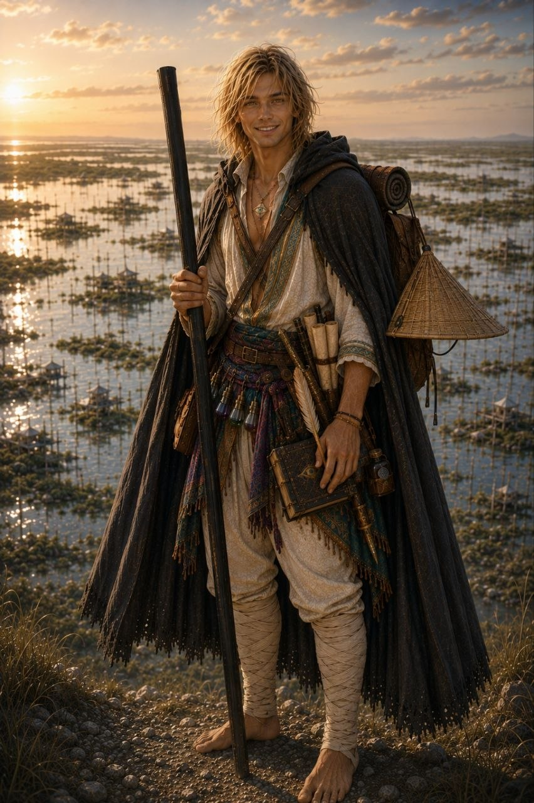

# Nataniel

Nataniel Clerive est un jeune iliari issu de la [Vallée du Sel](../../lieux/verteris/carcelie/vallee-du-sel/vallee-du-sel.md), province située au sud de [Verteris](../../lore/geographie/verteris.md), dams le royaume de [Carcelie](../../lieux/verteris/carcelie/carcelie.md).

## Quête

Nataniel parcourt le monde pour mieux comprendre les écritures runiques qu'il a découvertes dans les profondeurs de l'[Iris du Monde](../../lieux/verteris/carcelie/vallee-du-sel/vallee-du-sel.md), ainsi que les mystères qui entourent son peuple.

## Apparence

Comme tous les iliaris, Nataniel a les cheveux et les iris d'un blond doré, reflet du Kirine dont son peuple dépend pour vivre. Jeune homme vêtu pour le voyage, il porte sur lui ses carnets, son matériel alchimique et la fiole de Kir-Tan suspendue à son cou qui lui permet de survivre loin de la Vallée du Sel.

## Détails

| Détail       | Réponse                        |
| ------------ | ------------------------------ |
| Couleur      | Doré                           |
| Anniversaire | 25 de la Douzième Lune, 241 AA |

