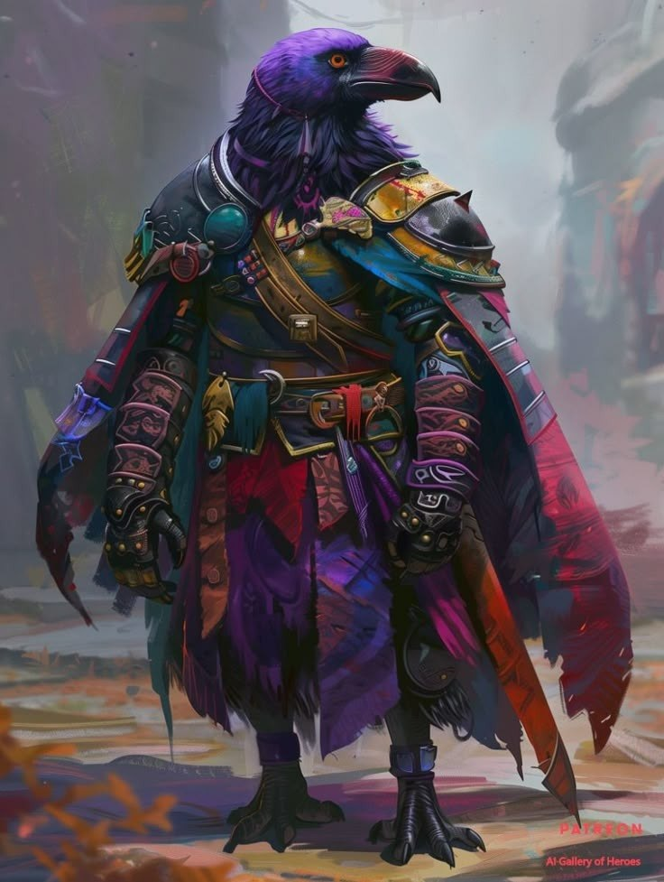

# Shin

Shin Akaze est un tengu, un homme-corbeau originaire du [Yu Feng](../../lore/geographie/yu-feng.md), dans la cité de [Tianshan](../../lieux/yu-feng/zhangkai/tianshan/tianshan.md). Archéologue de sa région, il a découvert une mystérieuse pierre lors d'une fouille qui semble résonner avec la broche en forme de plume léguée par son mentor disparu: Karasumaru. Il a dû précipitamment fuire son pays, car depuis cette trouvaille, des individus le traquent de près.

## Quête

 Shin tente de mieux comprendre les origines et les liens entre la broche remise par son maître et la pierre portée en médaillon trouvé dans les ruines. Cette dernière semble contenir des runes similaires à celles découvertes par [Nataniel](../nataniel/nataniel.md) dans sa région et [Corvenna](../corvenna/corvenna.md) dans le carnet de son mentor.

Autre mystère: la pierre ne semble pas émettre de magie, et Rikka, le renard de [Miyara](../miyara/miyara.md), semble réagir étrangement à sa présence.

## Apparence

### Physique

Comme tout tengu, Shin s'apparente à un homme-corbeau. De taille moyenne, il est fin et agile, parfait pour la discrétion. Son plumage est d'un noir profond aux reflets bleutés, qui vire à l'argent sous certains angles de lumière. Ses bras et ses jambes se terminent par des serres puissantes et acérées.

Il porte un large bec de corbeau, marqué d'une cicatrice bien visible sur la partie supérieure, souvenir d'une fouille qui a mal tourné. Une empreinte tribale blanche recouvre la moitié droite de son visage et descend sur son cou : le marquage de son clan.

### Tenue et équipement

Il porte une armure légère en cuir et une longue cape à capuche, fermée au cou par une broche en forme de plume, qui l'aide à planer dans les courants de vent. Ses mains sont couvertes de mitaines en cuir, laissant voir des doigts crochus ornés de plusieurs bagues, dont une chevalière gravée du sceau officiel de son clan, son « permis d'archéologue ».

Deux <abbr title="Sabres courts">wakizashi</abbr> sont accrochés à sa ceinture, aux fourreaux noirs et blancs décorés de symboles.

## Histoire

## Détails

| Détail       | Réponse                       |
| ------------ | ----------------------------- |
| Couleur      | Noir                          |
| Anniversaire | 6 de la Septième Lune, 239 AA |