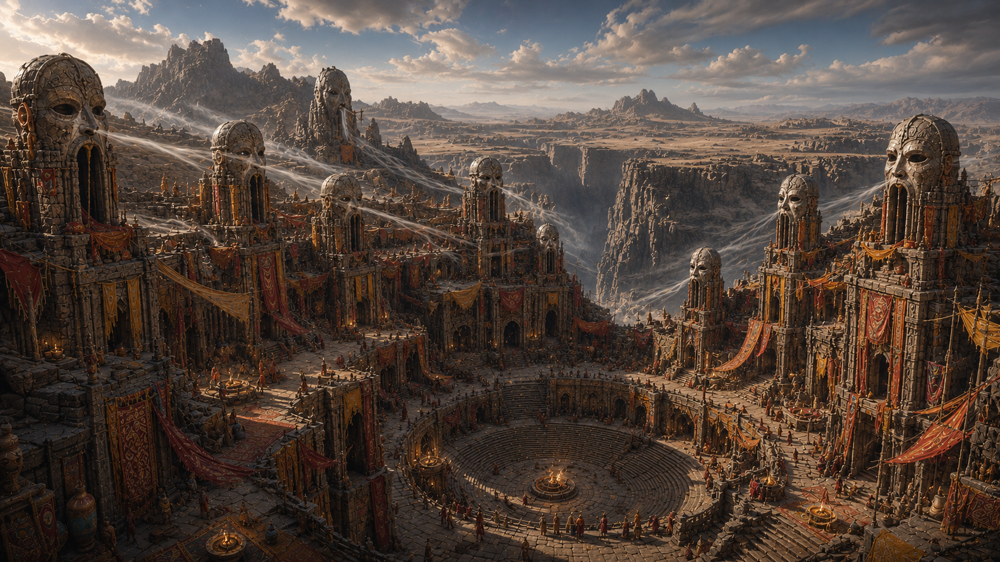

**Sorashinkai** est la capital religieuse de la province du Kuniyama dans le Yu-Feng

Bâtie là où deux ravines convergent en un amphithéâtre naturel. Construite à même les falaises, sur des plates-formes creusées dans le flanc des falaises.

Des sanctuaires bordent le sommet de la ville, exposé au vent des hauteurs. Sur ces sanctuaires, de grands masques de pierre taillés à même la roche sont tournés vers l'intérieur de la ville, quand les tempêtes balayent Kuniyama, ces masques résonnent comme des flûtes graves et les caveaux ancestraux situés au alentour des masques deviennent des cathédrales de sons. Les pèlerins disent que c'est ici que les morts parlent le plus fort.
