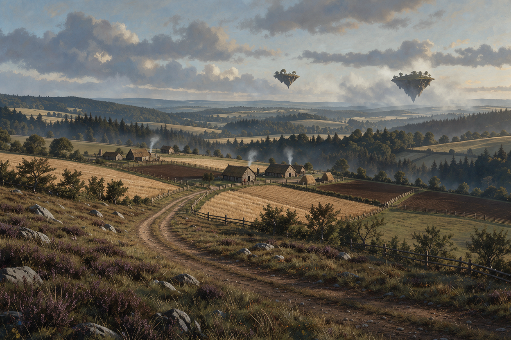

# Altera

Le royaume d'Altera siège au nord-est de [Verteris](../../../lore/geographie/verteris.md), étendu jusqu'aux côtes orientales de la région. Son territoire est situé sur un plateau d'altitude moyenne. Sa capitale arcanique, [La Celtane](./celtane/celtane.md), domine le centre du territoire, tandis que sa façade maritime lui assure un rôle commercial important.



## Géographie

### Provinces

| Nom      | Localisation | Description                                                                                                                                                        |
| -------- | ------------ | ------------------------------------------------------------------------------------------------------------------------------------------------------------------ |
| Aclive   | Sud          | Terres en pente orientées vers le sud, cultivées en terrasses sur les flancs.<br>                                                         |
| Aumont   | Centre-est   | Province montagneuse dominée par l'[Aumontus](./aumontus.md), un haut massif escarpé parcemé de villages perchés sur les crêtes.<br>       |
| Baroche  | Ouest        | Contreforts occidentaux étalés au pied d'un relief, entre roches et terres basses.<br>                                          |
| Loncost  | Est          | Long ruban côtier à l'est, tourné vers la mer et porté vers le commerce maritime.<br>                                                  |
| Vinlitus | Nord         | Littoral <abbr title="Qui est du côté nord">septentrional</abbr> battu par les vents, aux plages rudes et faiblement abritées.<br> |

### Frontières

| Nom                                              | Localisation |
| ------------------------------------------------ | ------------ |
| [Norgaard](../../../lore/geographie/norgaard.md) | Ouest        |
| [Traverse](../traverse/traverse.md)              | Sud          |

### Lieux notables

```base
filters:
  and:
    - file.path.startsWith("lieux/verteris/altera/")
    - file.ext == "md"
    - file.basename != "altera"
views:
  - type: cards
    name: Villes
    image: note.image
    imageAspectRatio: 1.75

```

## Faune et nature

Parmi l'éventail de produits que propose l'agriculture altérienne, on trouve l'**egnaro**: un gros fruit local qui ressemble à une orange, mais de la taille d'une pastèque. Endémique du royaume, il constitue une spécialité appréciée et aisément identifiable.

