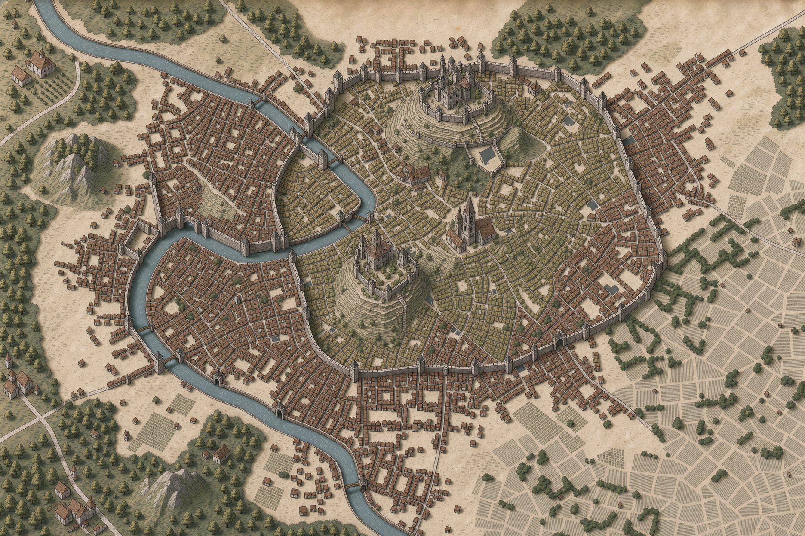

---
aliases:
  - Archceltis
title: La Celtane
alias: []
localisation: '[Verteris](../../../../lore/geographie/verteris.md)'
description: Capitale arcanique du royaume d'Altera
image: '[[./celtane.png]]'
tags:
  - arcane
  - lieu
  - récent
  - verteris
  - ville
---

# La Celtane

La Celtane est la capitale arcanique du royaume [Altera](../altera.md), situé à [Verteris](../../../../lore/geographie/verteris.md). C'est un lieu riche pour la recherche des arcanes. Elle est située en-dessous de l'Archceltis, une importante formation d'îles célestes flottant au-dessus de la ville.

## Carte

## Etablissements

### Au Livre Ouvert

Taverne située proche de l'Académie

## Archeltis

La ville est située en dessous d'une curiosité environmentale: l'Archceltis. Cet ensemble d'îles célestes forment un arc de cercle, incliné à la diagonale. Cette configuration très particulière a jadis attiré plusieurs apprentis dans l'art des arcanes, devenant une ville pionnière dans le domaine. Il est même possible que le terme "Archemage" était initialement donné à ceux qui étudiaient l'Archceltis.

Bien qu'encore étudiée, elle représente aujourd'hui plutôt un symbole que l'objet principale des recherches dans ce domaine.

## Gouvernement

La Celtane est dirigé par le Seigneur Clavius, qui réside dans le château centré au nord de la ville.

## Institutions

Plusieurs institutions liées au domaine des arcanes sont présentes dans la ville.

### Observatoire Milton

L'observatoire de La Celtane, nommé en hommage à la professeure Margeretta Milton, est un lieu destiné à observer ce qui se passe dans le ciel, et au-delà. C'est un lieu important pour les chercheurs dans l'étude des corps célestes et leur influence sur les arcanes.

### Académie

L'Académie de La Celtane, fondée par l'archimage Mathison Alturine, regroupe plusieurs collèges spécialisés.

| Nom | Domaine | Responsable | Fondateur |
| --- | --- | --- | --- |
| Collège du Consortium | Téléportation, communication | (inconnu) | (inconnu) |
| Collège de l'Unios | Dimensiologie | Archimage Benedict Orvalinus | Professurs Tomsone et Alistairi |
| Collège Adael | Runes et enchantements | Archimage Wu Enda | (inconnu)  |
