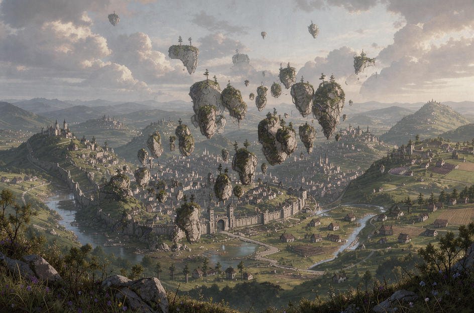
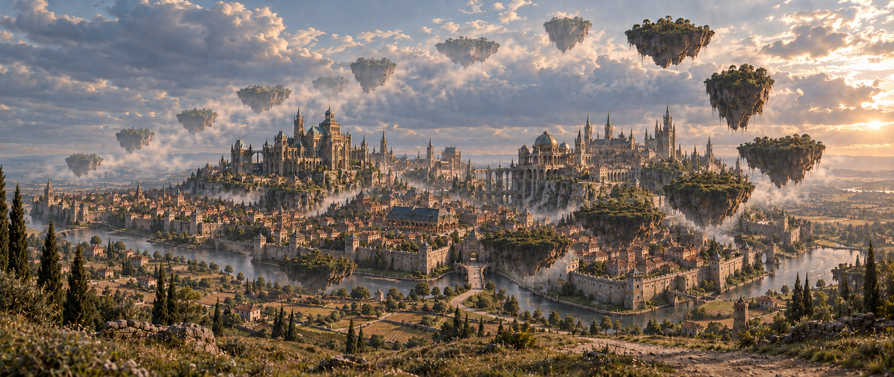

# La Celtane

La Celtane est la capitale arcanique du royaume [Altera](../altera.md), situé à [Verteris](../../../../lore/geographie/verteris.md). C'est un lieu riche pour la recherche des arcanes. Elle est située en-dessous de l'Archceltis, une importante formation d'îles célestes flottant au-dessus de la ville.

## Apparence

La ville est encerclée par des douves parfaitement circulaires ont été installées de hauts murs de pierre. Derrière, on trouve une cité au relief accidenté qui dessinent des collines et des micro falaises où sont posés les diverses bâtiments.

La Celtane respire la magie. Les échoppes et les marchés sont souvent tenus par des gérants qui utilise les arcanes pour les aider dans leur tâches. Dans les établissements les plus prestigieux, on aperçoit parfois des balais nettoyer le sol de manière autonome. 

Dans les quartiers proches de l'Académie, il est fréquent de voir les mages accompagnés de servants invoqués par leur soins pour les aider dans leurs tâches. La nuit, les ruelles pavées sont illuminés de gros cristaux maintenus par des armatures en métal. Leur couleur varie selon le quartier.

## Population

La Celtane est cosmopolite. Vers les fermes et dans les ruelles, des passants affichent des pupilles rectangulaires et étirées, tel ceux trouvés chez les moutons. D'autres affichent des cornes torsadées, sortant de leur chevelure et tirant sur l'arrière de leur crâne. Plusieurs races et ethnies se dessinent dans le paysage pour former une population diverse et variée.

## Carte

## Points d'intérêt

### Archeltis

La ville est située en dessous d'une curiosité environmentale: l'Archceltis. Cet ensemble d'îles célestes forment un arc de cercle, incliné à la diagonale. Cette configuration très particulière a jadis attiré plusieurs apprentis dans l'art des arcanes, devenant une ville pionnière dans le domaine. Il est même possible que le terme "Archemage" était initialement donné à ceux qui étudiaient l'Archceltis.

Bien qu'encore étudiée, elle représente aujourd'hui plutôt un symbole que l'objet principale des recherches dans ce domaine.

## Etablissements

### Au Livre Ouvert

Taverne située proche de l'Académie

## Institutions

Plusieurs institutions liées au domaine des arcanes sont présentes dans la ville.

### Château de La Celtane

La Celtane est dirigé par le Seigneur Clavius, qui réside dans le château centré au nord de la ville.

### Académie

L'Académie de La Celtane, fondée par l'archimage Mathison Alturine, est un des établissement les plus important de la ville.

Elle regroupe plusieurs collèges spécialisés.

| Nom                   | Domaine                      | Responsable                             | Fondateur                                    |
| --------------------- | ---------------------------- | --------------------------------------- | -------------------------------------------- |
| Collège du Consortium | Téléportation, communication | (inconnu)  | (inconnu)                                    |
| Collège de l'Unios    | Dimensiologie                | Archimage Benedict Orvalinus            | Professurs Tomsone et Alistairi              |
| Collège Adael         | Runes et enchantements       | Archimage Wu Enda                       | (inconnu)  |

### Observatoire Milton

L'observatoire de La Celtane, nommé en hommage à la professeure Margeretta Milton, est un lieu destiné à observer ce qui se passe dans le ciel, et au-delà. C'est un lieu important pour les chercheurs dans l'étude des corps célestes et leur influence sur les arcanes.

