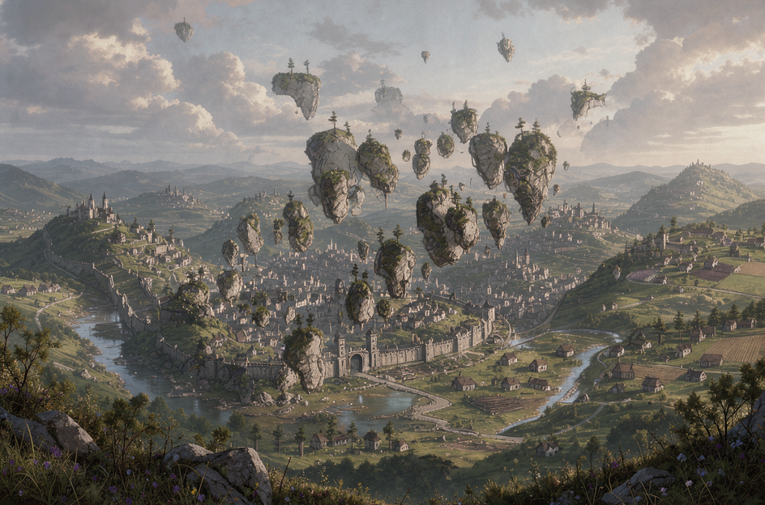
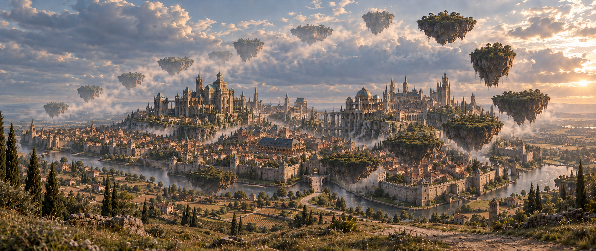
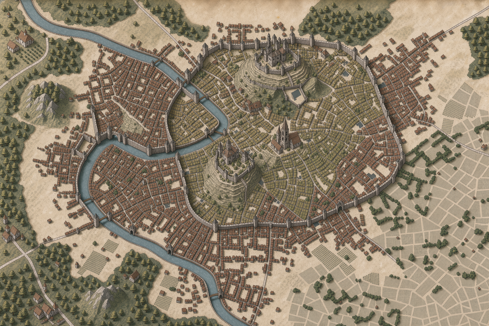

# La Celtane

La Celtane est la capitale arcanique du royaume [Altera](../altera.md), situé à [Verteris](../../../../lore/geographie/verteris.md). C'est un lieu riche pour la recherche des arcanes. Elle est située en-dessous de l'Archceltis, une importante formation d'îles célestes flottant au-dessus de la ville.

## Apparence

La ville est encerclée par des douves parfaitement circulaires ont été installées de hauts murs de pierre. Derrière, on trouve une cité au relief accidenté qui dessinent des collines et des micro falaises où sont posés les diverses bâtiments.

Au centre de la ville passe un fleuve nommé la <abbr title="Longue Veine">Longavena</abbr>, utilisés notamment par quelques bateaux marchands.

La Celtane respire la magie. Les échoppes et les marchés sont souvent tenus par des gérants qui utilise les arcanes pour les aider dans leur tâches. La nuit, les ruelles pavées sont illuminés de gros cristaux maintenus par des armatures en métal. Leur couleur varie selon le quartier.

## Population

La Celtane est cosmopolite. Vers les fermes et dans les ruelles, des passants affichent des pupilles rectangulaires et étirées, tel ceux trouvés chez les moutons. D'autres affichent des cornes torsadées, sortant de leur chevelure et tirant sur l'arrière de leur crâne. Plusieurs races et ethnies se dessinent dans le paysage pour former une population diverse et variée.

## Carte

## Points d'intérêt

### Archeltis

La ville est située en dessous d'une curiosité environmentale: l'Archceltis. Cet ensemble d'îles célestes forment un arc de cercle, incliné à la diagonale. Cette configuration très particulière a jadis attiré plusieurs apprentis dans l'art des arcanes, devenant une ville pionnière dans le domaine. Il est même possible que le terme "Archemage" était initialement donné à ceux qui étudiaient l'Archceltis.

Bien qu'encore étudiée, elle représente aujourd'hui plutôt un symbole que l'objet principale des recherches dans ce domaine.

## Etablissements

## Institutions

Plusieurs institutions liées au domaine des arcanes sont présentes dans la ville.

### Cathédrale

Cathédrale unifiée, accueillant toute sorte de fidèles.

### Château de La Celtane

La Celtane est dirigé par le Seigneur Clavius, qui réside dans le château centré au nord de la ville.

### Académie

L'Académie de La Celtane, fondée par l'archimage Mathison Alturine, est un des établissement les plus important de la ville. Le campus se dresse comme une forteresse de pierre entourée de murs épais, accessible via un chemin qui serpente dans la colline verdoyante parsemée de cristaux luminescents.

Entre les murs, une cour aux graviers blancs s'ouvre sur des bâtiments officiels aux pierres claires. L'un d'eux, *Au Livre Ouvert*, sert de taverne tant aux membres qu'au public.

L'Académie regroupe plusieurs collèges spécialisés.

| Nom                   | Domaine                      | Responsable                  | Fondateur                                    |
| --------------------- | ---------------------------- | ---------------------------- | -------------------------------------------- |
| Collège du Consortium | Téléportation, communication | Archimage Timbe Neserli      | (inconnu)                                    |
| Collège de l'Unios    | Dimensiologie                | Archimage Benedict Orvalinus | Professurs Tomsone et Alistairi              |
| Collège Adael         | Runes et enchantements       | Archimage Wu Enda            | (inconnu)  |
| Collège Bresenham     | Illusion                     | Archimage Warnock            | (inconnu)          |

#### Bibilothèque

La Bibliothèque de l'Académie de [La Celtane](./celtane.md) est divisée en plusieurs niveaux d'accès, chacun réservé à un statut précis.

Le niveau public est ouvert aux visiteurs et aux simples curieux. Le niveau 1 est réservé aux membres enregistrés, généralement des étudiants, assistants ou autres enseignants. Les niveaux supérieurs sont réservés aux professeurs et chercheurs confirmés, où les recherches sensibles sur le [Vibrellis](../../../plots/main/vibrellis/vibrellis.md), les plans ou la religion sont strictement encadrées.

Les registres sont tenus par **Alina Newell**, responsable de la bibliothèque.

### L'Arche Cachée

Auberge discrète taillée dans la roche, située près de l'Académie. Son entrée, facile à manquer, s'ouvre sur une salle voûtée chaleureuse éclairée au feu de bois. L'aubergiste y sert la *Granite Verte*, une bière locale à base de sève de sapin. On y joue au « Jeu de la pièce » : les participants jettent des pièces de cuivre et d'argent dans un verre d'eau ; une fois mates et indifférenciables, chacun pioche au hasard. L'établissement propose aussi des services plus discrets, loin des regards de la justice.

### Observatoire Milton

L'observatoire de La Celtane, nommé en hommage à la professeure Margeretta Milton, est un lieu destiné à observer ce qui se passe dans le ciel, et au-delà. C'est un lieu important pour les chercheurs dans l'étude des corps célestes et leur influence sur les arcanes.

## Culture

### Gastronomie locale

Le pavé d'argent est un plat typique de [La Celtane](./celtane.md) : une pâtisserie à base de sucre brillant et argenté, le Sucre d'Argent, dont le pavé ressemble à un brownie moelleux à la vanille.

