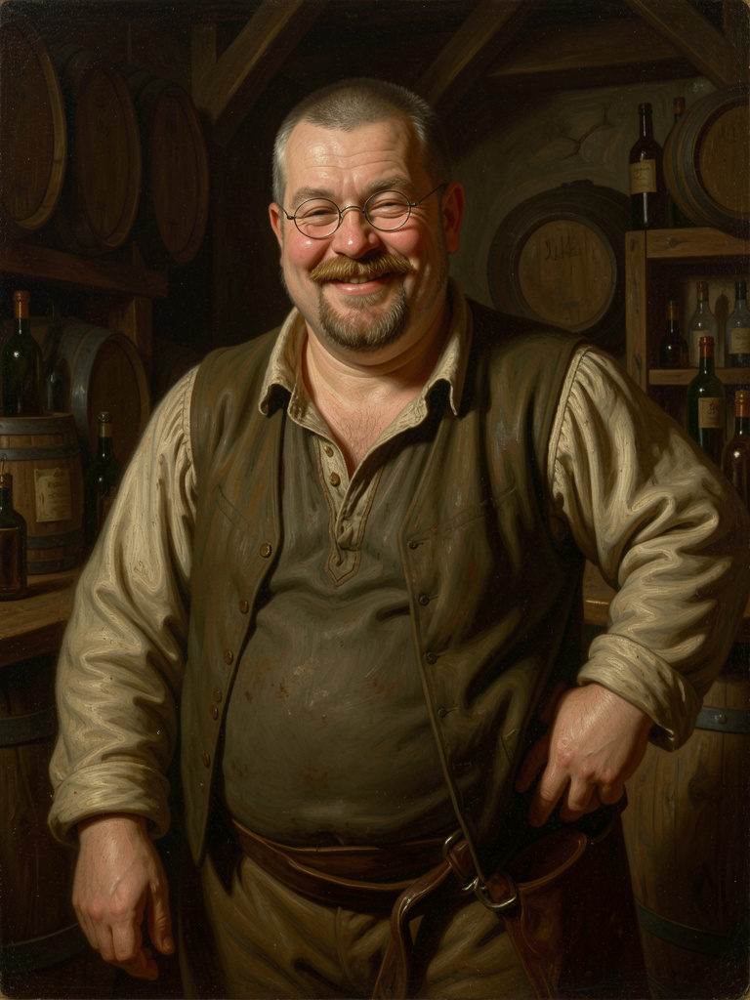

# Descapras

<abbr title="Dix Chèvres">Descapras</abbr> est un petit village situé dans la province d'Aclive, dans le royaume d'[Altera](../altera.md) à [Verteris](../../../../lore/geographie/verteris.md).

## Etablissements

### Auberge du Vieux Bouc

La seule auberge du village, tenue par le sympathique **Merolas**, le ténor de l'établissement. Bon vivant, généreux, il tient sa taverne comme un second foyer ouvert à tous.

Merolas est un homme trapu d'une soixantaine d'années, le visage rond et les pomettes rosées. Son crâne affiche quelques courts cheveux gris, et sa barbe rase poivre et sel accompagne une franche moustache au-dessus d'un sourire franc. Ses yeux pétillants plissent aux coins quand il rit.

Ses mains, larges et calleuses, témoignent d'une vie de service: il porte les cruches et les plateaux comme il porte les conversations, avec une familiarité chaleureuse.

## Destinations voisines

| Nom                                 | Distance | Durée à pied |
| ----------------------------------- | -------- | ------------ |
| [Acerflot](../Acerflot/acerflot.md) | ~175km   | ~6 jours     |
| [La Celtane](../celtane/celtane.md)         | ~200km   | ~1 semaine   |
