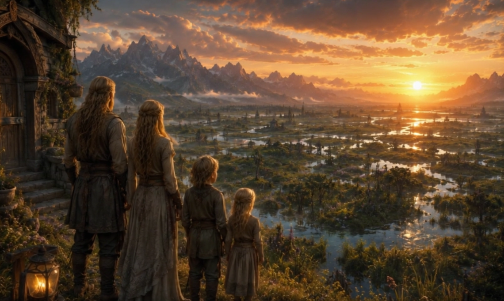

# La Vallée du Sel

La Vallée du Sel, également appelée *Iliari*, est une province marécageuse située au sud de [Verteris](../../../../lore/geographie/verteris.md), dans le royaume de [Carcelie](../carcelie.md). Située entre les [Aiguilles de Brume](../aiguilles-brume.md) et un réseau dense de mangroves, la région s'est partiellement isolée du reste du royaume.

## Introduction

La Vallée du Sel, également appelée **Iliari** par ses habitants, est une région isolée, semi-inondée, d'une grande richesse écologique et spirituelle, située à l'écart de toute route stratégique ou intérêt militaire majeur. Elle est façonnée par une particule vivante et dorée appelée **Kirine**, omniprésente dans ses eaux, ses sols et sa faune. Le Kirine forme la base de la chaîne alimentaire locale et s'accumule dans les organismes vivants, leur conférant des reflets dorés caractéristiques. Seuls les Iliari, peuple pacifique et agraire, sont capables de le métaboliser. Ils en consomment quotidiennement, directement à travers la nourriture locale ou sous forme de Kir-Tan, une pâte concentrée qu'ils élaborent en filtrant l'eau des profondeurs.

Au cœur de la vallée se trouve l'**Iris du Monde**, une immense fosse subaquatique parfaitement circulaire, à la profondeur inconnue, d'un bleu si sombre qu'il paraît noir, saturé de particules dorées de Kirine en suspension. 

Le climat de la vallée est chaud, humide et saturé de brumes salines, avec de grandes variations d'humidité et des nappes d'eau imprévisibles. Le niveau des eaux y varie brutalement, rendant la navigation hasardeuse pour les étrangers. 

La topographie contribue à l'isolement de la région. Trois côtés de la vallée sont entourés de montagnes abruptes et infranchissables, ne laissant qu'un col unique au nord, seul point d'entrée viable. 

Sans gouvernement central ni armée, les Iliari vivent dans un réseau de petites cités autonomes, où l'ordre est assuré par des milices locales. Leur isolement géographique, la toxicité du Kirine pour les étrangers et la marginalité économique de leurs ressources sur le marché mondial font de la vallée un refuge protégé, à la fois sanctuaire culturel, écosystème préservé et objet de fascination pour les rares voyageurs qui parviennent jusqu'à ses rives.

## Climat

Le climat de la Vallée du Sel est à la fois chaud, humide et instable, modelé par la présence constante d'eaux stagnantes, de brumes salines et de micro-précipitations éparses. Les journées sont généralement lourdes, baignées d'une chaleur diffuse entretenue par la réverbération du soleil sur les nappes d'eau peu profondes et les cristaux de sel. L'humidité ambiante est quasi permanente, alimentée par l'évaporation des canaux, les remontées capillaires et les précipitations régulières.

Les nuits, quant à elles, sont souvent plus fraîches, mais enveloppées de brouillards épais qui masquent les reliefs et rendent toute navigation nocturne périlleuse. Il pleut rarement de façon franche, mais l'atmosphère est fréquemment chargée de condensations fines, qui s'accumulent sur la peau, les vêtements et les abris. Ce climat particulier favorise l'émergence d'une biodiversité unique, mais impose également une adaptation constante des habitants et des voyageurs aux caprices changeants de la vallée.

## Géographie

La Vallée du Sel est délimitée par les [Aiguilles de Brume](../aiguilles-brume.md), une imposante chaîne de montagnes située sur la majeure partie de son pourtour nord, tandis que son flanc sud donne sur la mer. Dans cette zone méridionale, les montagnes s'adoucissent en collines dont les bases accueillent des mangroves denses. Ces écosystèmes jouent un rôle crucial en amortissant les marées et en stabilisant les berges.

### Généralités

La Vallée du Sel est une vaste dépression géographique située en contrebas du reste du continent. Elle se caractérise par la présence constante et ubiquitaire d'eau salée sur l'ensemble de son territoire, formant un immense marécage aux profondeurs variables. Le niveau d'eau y oscille entre quelques centimètres et plusieurs mètres, avec une profondeur moyenne atteignant la mi-mollet d'un adulte.

La Vallée du Sel est une région profondément isolée, difficile d'accès tant par voie terrestre que maritime. Elle est encerclée au nord, à l'est et à l'ouest par un demi-cercle de montagnes escarpées, formant une barrière naturelle presque infranchissable. Seuls quelques cols étroits, peu connus et rarement empruntés, permettent de relier la vallée aux régions voisines, et leur traversée demeure dangereuse, notamment en saison humide.

### L'Iris du Monde

L'Iris du Monde est une vaste fosse subaquatique située au cœur de la vallée. Parfaitement circulaire et mesurant plusieurs centaines de mètres de diamètre, cette fosse est probablement un des endroits les plus sacré d'Iliari.

L'Iris du Monde se distingue par une salinité exceptionnelle, la concentration de sels étant maximale au niveau de l'Iris et décroissant progressivement à mesure que l'on s'en éloigne. Ce gradient de salinité confère à la Vallée du Sel un écosystème unique en son genre, n'étant pas retrouvé ailleurs dans le monde.

L'Iris du Monde est d'une profondeur inconnue. Bien qu'il soit établi que la salinité de l'eau de la Vallée du Sel vienne de cette fosse subaquatique, l'origine exacte du sel, du kirine et des mécanismes de leur propagation dans la Vallée du Sel reste encore à éclaircir.

#### Situation et signification culturelle

Situé au cœur de la Vallée du Sel, l'Iris du Monde est entouré de croyances profondes dans la culture iliari. Il s'agit du point central autour duquel s'organise **Dernier Refuge**, la cité principale de ce peuple.

Tout comme le sel de la Vallée, c'est également de l'Iris du Monde que semble émerger le Kirine, avant de se diffuser lentement dans le reste de la vallée du Sel. Selon les traditions orales des Iliari, c'est également le point d'origine de leur peuple; guidé par leur dieu Ili, en faisant un lieu sacré.

#### Exploitation et propriétés singulières

L'Iris du Monde est notamment exploité pour son sel unique. Des plongeurs expérimentés, appelés **Corps Calmes**, y extraient du sel cristallisé directement des parois immergées.

### Dernier Refuge

Dernier Refuge est la cité principale de la Vallée du Sel, construite en cercle autour de l'Iris du Monde. 

La ville est partiellement submergée. Elle se compose d'îlots habités reliés entre eux par des passerelles, de quais inondés, de salles communes surélevées et de plateformes de sel cristallisé, blanches et lisses, sur lesquelles s'élèvent des constructions simples et fonctionnelles. 

### Les mangroves du Sud

Au sud de la Vallée du Sel s'étendent les mangroves profondes, un entrelacs de racines immergées, d'arbres tordus et de canaux étroits noyés sous une lumière diffuse et saline. 

### Les montagnes

Les montagnes qui encerclent la Vallée du Sel forment une muraille naturelle presque continue, un croissant rocheux abrupt et minéral qui isole la région du reste du monde. Il n'existe aucune route directe à travers ces chaînes rocheuses, seulement des escarpements déchiquetés. 

## Écologie

### Le Kirine

L'ensemble de l'écosystème de la région repose sur une minuscule particule dorée omniprésente : le **Kirine**. Cette particule émane en flux régulier depuis les profondeurs de l'Iris du Monde et teinte discrètement l'eau de la région d'une touche dorée. Elle joue un rôle central dans la chaîne alimentaire, à l'image du plancton dans les océans.

Le Kirine est à la base de la chaîne alimentaire de la Vallée, consommé par des petits organismes eux-mêmes chassés par des prédateurs. On observe donc une accumulation de kirine dans les organismes des animaux de la région, qui arborent des motifs dorés sur le corps (dos de grenouilles, moustaches de poissons-chats, serres de hérons). Certaines espèces de plantes, dont des plantes carnivores et certaines fougères, prennent également des teintes dorées similaires. Les animaux arborant des signes d'imprégnation au kirine (espèces animales ou les Iliari eux-mêmes) doivent en consommer régulièrement pour rester en bonne santé.

Le kirine semble être toxique pour les créatures n'étant pas originaires d'Iliari : nausée, faiblesse musculaire, vomissements durant habituellement plusieurs heures avant de se résoudre spontanément. Sans ingestion de kirine ou de Kir-Tan, le sujet sombre dans le coma avant de décéder après plusieurs jours.

### Biodiversité

La région d'Iliari se distingue par une biodiversité exceptionnelle, soutenue par des conditions écologiques particulières et une faible pression humaine. On y observe une grande diversité animale et végétale, favorisée par la rareté des activités de chasse et la présence limitée de superprédateurs.

## Agriculture et alimentation

La culture vivrière reste strictement locale. En raison de la présence du kirine, les denrées produites dans la vallée sont impropres à la consommation extérieure sans traitement. 

### Pêche

Les besoins alimentaires de la population locale sont principalement assurés par une pêche artisanale: harponnage de poissons, crustacés et plantes aquatiques adaptées à l'environnement salin. La perche des marais y est de loin la prise la plus chassée.

## Les Iliaris

Les Iliari sont le peuple résidant dans la Vallée du Sel, souvent elle-même désignée sous le nom d'Iliari en référence à ses habitants. Il s'agit d'une société à la fois pacifique, agraire et modestement développée sur le plan technologique, qui a appris à survivre dans les conditions rudes et salines de la région.

### Relation avec le Kirine

Le Kirine est essentiel à la survie des Iliari. Imprégné dans leur organisme, il leur confère à tous des **cheveux et des iris d'un blond doré**. Ils en consomment quotidiennement, que ce soit par l'intermédiaire de la faune locale ou sous forme concentrée. En cas de privation prolongée, les Iliari souffrent de fatigue, nausées, tremblements, et peuvent mourir s'ils ne réintroduisent pas rapidement du Kirine dans leur alimentation.

Afin d'assurer un apport constant, les Iliari ont mis au point un procédé élaboré pour récolter le Kirine : l'eau contenant le kirine est filtrée à l'aide de tamis très fins, la matière extraite est ensuite séchée grâce à une méthode sophistiquée. Le résultat est une pâte dense appelée **Kir-Tan**, utilisée en cuisine, en particulier lorsque les Iliari vivent hors de la vallée. Chaque Iliari voyageant en dehors de la Vallée du Sel possède ses réserves de Kir-Tan, généralement sous la forme d'une petite boîte facilement transportable, qui permettent de tenir de nombreux mois en autonomie.

### Effets du kirine sur les non-Iliari

Le Kirine, bien que vital pour les Iliari, est toxique pour les autres espèces. Toute ingestion, même minime, provoque chez les non-Iliari des nausées intenses, vomissements et parfois faiblesse musculaire, rendant la substance incompatible avec toute autre forme de vie étrangère à la Vallée du Sel.

