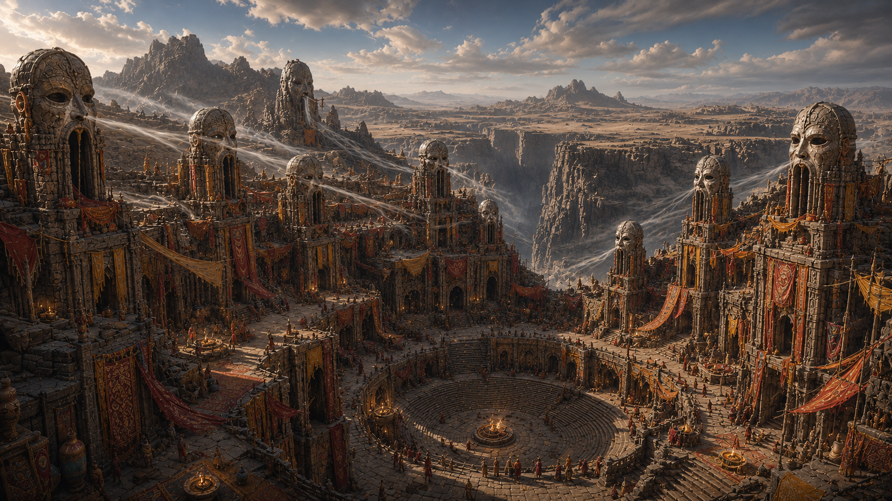

# Sorashinkai

**Sorashinkai** est la capitale religieuse de la province de [Kuniyama](kuniyama.md), dans le [Yu Feng](../../../../../lore/geographie/yu-feng.md).

Bâtie là où deux ravines convergent en un amphithéâtre naturel, elle est construite à même les falaises, sur des plates-formes creusées dans le flanc des parois. C'est le siège du clergé, celui des **Aerialists**, qui détient l'autorité spirituelle sur la province.

Des sanctuaires bordent le sommet de la ville, exposé au vent des hauteurs. Sur ces sanctuaires, de **grands masques de pierre** taillés à même la roche sont tournés vers l'intérieur de la ville : quand les tempêtes balayent Kuniyama, ces masques résonnent comme des flûtes graves et les caveaux ancestraux situés alentour deviennent des « cathédrales de sons ». Les pèlerins disent que c'est ici que les morts parlent le plus fort.

## Destinations voisines

| Nom                                        | Description                           |
| ------------------------------------------ | ------------------------------------- |
| [Akazengkai](akazengkai/akazengkai.md)                | Capitale du gouvernement et commerce   |
| [Kuniyama](kuniyama.md)                    | Province environnante                  |