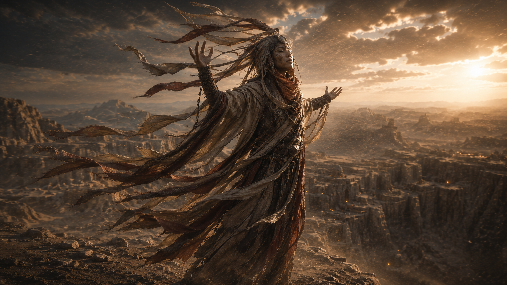
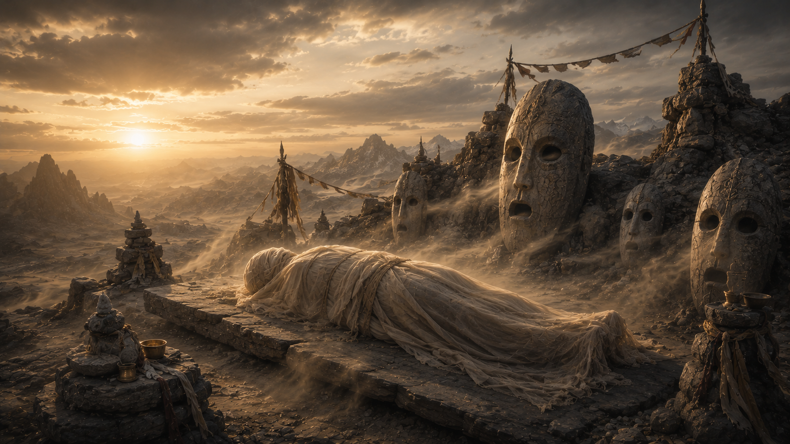

# Kuniyama

Kuniyama est une province montagneuse balayée par les vents, dans le [Yu Feng](../../../../lore/geographie/yu-feng.md), le royaume de [Xin Mishu](../xin-mishu.md), à la frontière du Nassahr. C'est le berceau des **Tribus Skywhisper**, un peuple endurci par le vent et profondément spirituel, qui croit que le vent porte la voix des morts.

## Religion et spiritualité

Les habitants de Kuniyama croient que le vent est la voix collective d'esprits invisibles. Chaque rafale est leur murmure, les brises portent des souvenirs, les tempêtes portent la colère, les courants d'air doux sont des bénédictions.

Les prêtres, appelés **Aerialists**, portent des bandes de tissu qui flottent violemment tandis qu'ils « écoutent » les rafales et en interprètent le sens. Les prophètes inhalent le « souffle de tempête » pour provoquer des visions.

### Pratique funéraire

Le corps des défunt est enveloppé dans un tissu poreux et placé sur une hauteur exposée afin que le vent l'emporte grain par grain. Les restes sont balayés dans des urnes de pierre scellées appelées Urne de Silence, contenant ce que le vent a décidé de laisser derrière lui, puis placé dans un cimetière à ciel ouvert.

## Faune et Flore

### Faune

#### Serpent à dos-de-verre

Serpents aux écailles transparentes ou irisées comme un miroir qui se prélassent contre la pierre polie par le vent, presque invisibles en plein soleil. Leur venin peut provoquer une paralysie profonde, et ils s'enroulent autour des veines de minerai encore chaudes du soleil. Les prospecteurs les craignent plus que les effondrements ; certains disent que leurs corps se forment à partir des « mues » du vent lui-même.
