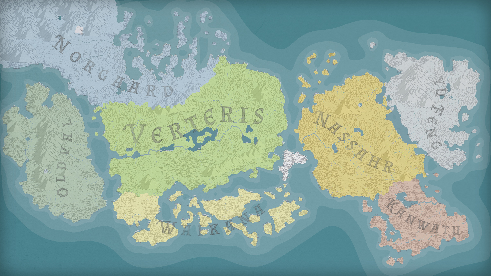

# Géographie

Au début de l'[Âge des Arcanes](../histoire/05.age-des-arcanes.md), Asema se sont divisées en sept grands continents appelés *régions*. Ces dernières sont communément nommées en fonction de leur environnement et de leur biome. Elles sont composées de plusieurs pays, qui partagent entre eux quelques similarités culturelles, sans pour autant les unirs politiquement.

| Nom officiel                       | Nom commun          | Localisation  | Equivalence         |
| ---------------------------------- | ------------------- | ------------- | ------------------- |
| [Norgaard](./norgaard.md) | Régions des Glaces  | Nord-Ouest    | Norois / Scandinave |
| [Oldval](./oldval.md)     | Régions des Vallées | Extrême-Ouest | Anglo-saxon         |
| [Verteris](./verteris.md) | Régions des Plaines | Centre-Ouest  | Latin               |
| [Waikana](./waikana.md)   | Régions de l'Eau    | Centre-Sud    | Polynésien          |
| [Nassahr](./nassahr.md)   | Régions du Sable    | Centre-Est    | Arabe               |
| [Yu Feng](./yu-feng.md)   | Régions du Vent     | Extrême-Est   | Asiatique           |
| [Kanwatu](./kanwatu.md)   | Régions du Feu      | Sud-Est       | Africain            |

## Diversité continentale

Chacune des sept régions se compose de multiples pays et royaumes, unis par des législations communes et l'usage de la [langue régionale](../langues.md#Langues%20régionales). Ces pays sont généralement eux-même divisés par provinces.

`Régions (continents) > Royaumes (pays) > Provinces (cantons)`

D'importantes différences géographiques et climatiques caractérisent cependant toutes ces nations. Par exemple, certaines contrées peuvent tout à fait présenter des zones enneigées importantes, y compris en dehors du territoire de Norgaard.

Il en est de même pour les ressources et la magie. Bien que certains éléments de la nature se retrouvent uniformément sur toutes les terres, chaque région propose une faune, une végétation, des minerais et des phénomènes arcaniques uniques à son territoire.

Sur chaque continent, on observe des races communes. Humains, elfes, nains, gnomes, halfelins, orcs et goblins sont typiquement des espèces internationales. Toute ethnie partage des traits liés à leur région respective. Ainsi, un nain originaire de la région des Sables aura une peau basanée et une chevelure sombre.

Les pays au sein d'une même région ont souvent leurs propres caractéristiques culturelles et sociétales. Ces facteurs expliquent pourquoi des tensions peuvent émerger entre des états voisins, pouvant parfois dégénérer en d'importants conflits inter-continentaux.

## Îles Célestes

Le ciel d'Asema accueille de nombreuses îles célestes. Ces grandes parcelles de terre suspendues dans les airs semblent défier les lois de la gravité. Généralement immobiles, elles varient en taille et en forme. Elles attisent tant la curiosité des physiciens que des mages.

## Conseil des Sept Régions

Tous les 4 ans, lors de la [Semaine de Transition](../calendrier.md#Semaine%20de%20Transition), a lieu le **Conseil des Sept Régions**. Lors de cet événement, des représentants des sept régions sont réunis pour prendre d'importantes décisions visant à garantir la cohésion entre les contrées.

Les ministères varient d'une région à l'autre: alors que certaines établissent un pays porte-parole, d'autres organisent des tournus ou envoient plusieurs représentants en fonction du climat politique actuel.