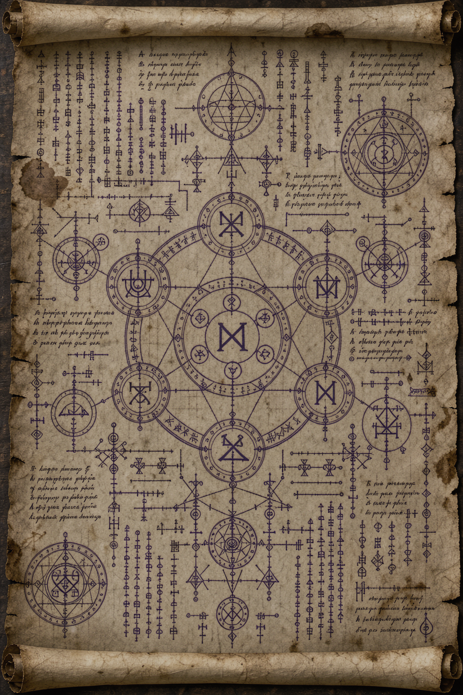
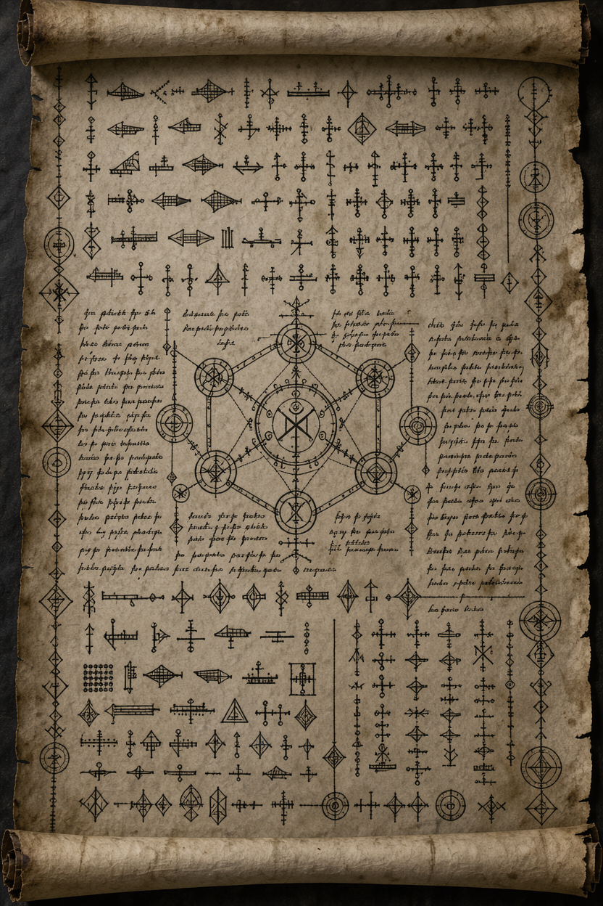

# Vibrellis

Le Vibrellis, également appelé *Runes de Conway*, est un mystérieux langage récurrent dans plusieurs régions du monde d'Asema.

## Apparence

Le Vibrellis s'apparente à des glyphes aux formes à la géométrie simple mais à l'agencement complexes, organisés en modules et reliés entre eux par des lignes.

Une particularité du Vibrellis, et qui lui tient son nom, est que l'écriture semble vibrer lorsqu'on l'observe attentivement.

 

> [!NOTE]
> Les images ci-dessous sont abstraction de ce à quoi on peut s'attendre visuellement. Ce n'est pas une réplication exacte des runes et des glyphes*

