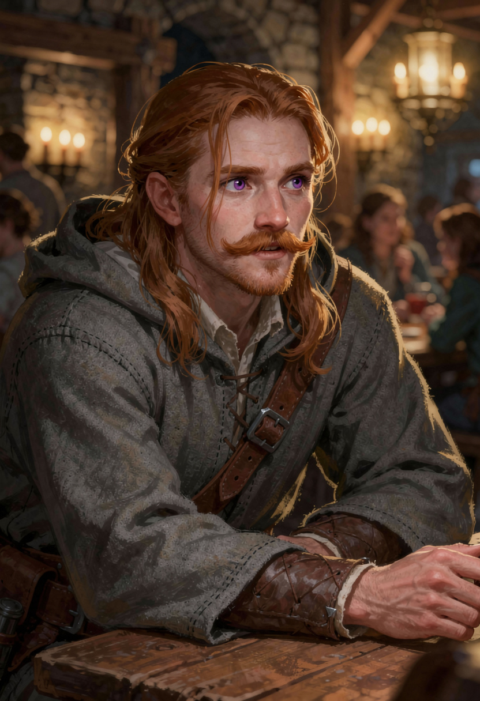

# Longitimuss

Longitimuss est un apprenti dimensiologue qui travaille au collège de l'Unios, à l'Académie de [La Celtane](../../lieux/verteris/altera/celtane/celtane.md). Il est un des élèves de l'archimage Orvalinus.

