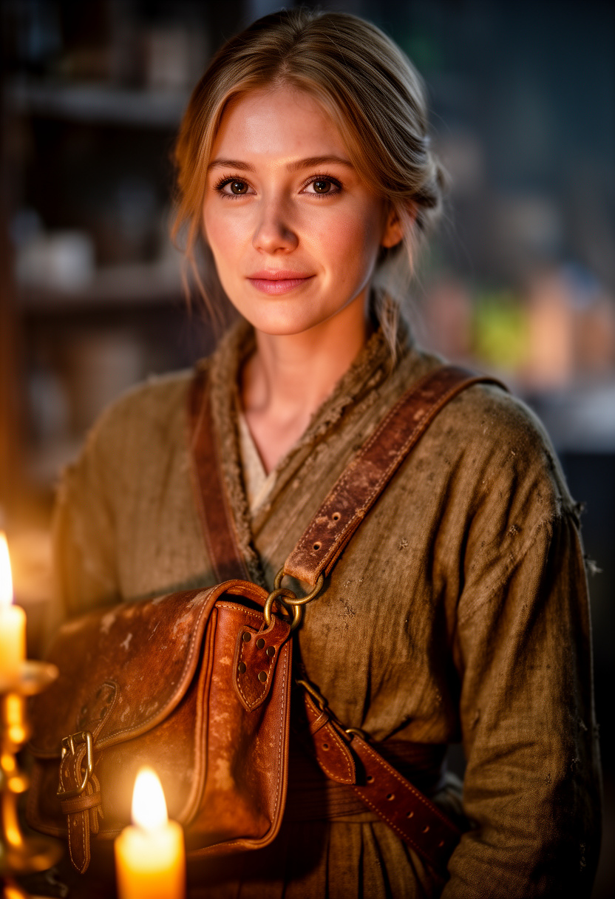

# Lorquena

Lorquéna Domlénar est une archiviste itinérante, travaillant surtout dans l'est de [Verteris](../../lore/geographie/verteris.md).

## Apparence

Lorquéna est une femme qui a approche lentement la quarantaine. Sa silhouette gracile et discrète accompagne une peau claire qui affiche de fines rides au coin des yeux. Ses cheveux châtains clairs affichent des mèches blondes généralement noués en chignon. Son regard aux reflets noisettes brille à la découverte de nouveaux ouvrages.

Elle est régulièrement accompagnée d'une besace de cuir en bandoulière renfermant ses instruments d'écriture, quelques lettres scellées et des carnets de notes.