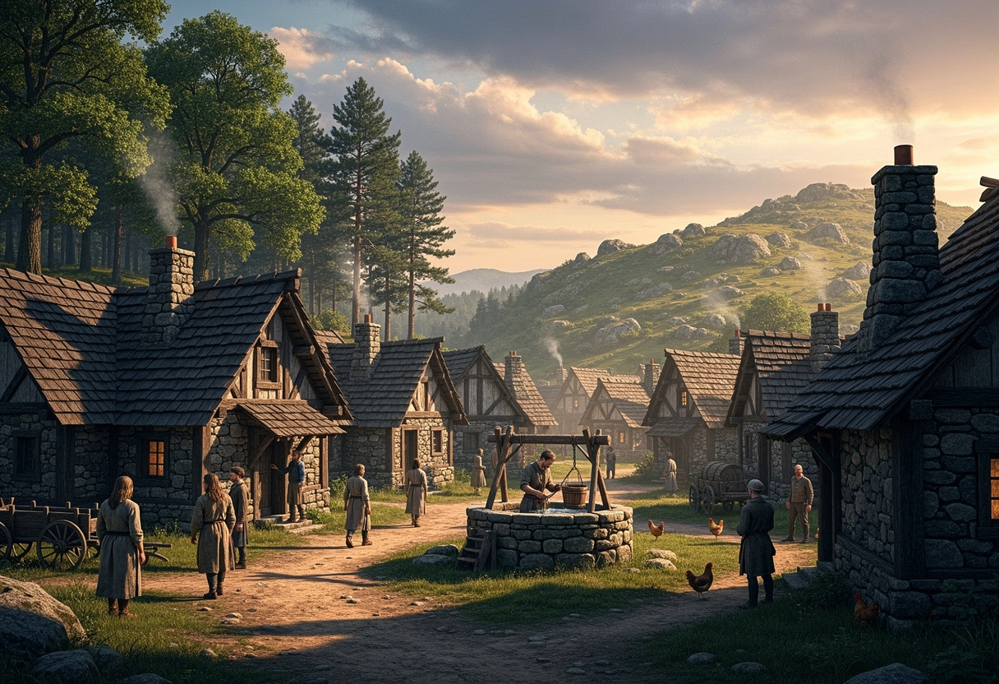

# Première rencontre

« Le sac à dos »

<a href="https://www.youtube.com/watch?v=qHfDPCIn2HQ" target="_blank" rel="noopener"><i class="pixel-icon-music"></i> Braum — League of Legends</a>

« Il est temps. Que cela soit par conviction ou par obligation, vous devez partir. Maintenant que votre départ est décidé, vous frémissez à l'idée de son approche ; car au fond de vous, vous l'avez déjà compris. L'horizon vous attend.

Derrière les collines se cache un monde qu'on vous a conté dans les fables et les légendes. D'immenses étendues de terre qui s'arrêtent là où en commencent de plus grandes. On vous a décrit les villes de royaumes voisins et les rituels de peuples lointains. Vous les avez vues sur les cartes et entendues dans les chants.

Mais bientôt, vous ne serez plus lecteur ni spectateur… Bientôt, vous deviendrez le conteur d'aventures que peu pourront prétendre avoir vécu.

Vous commencez vos préparatifs. Vous déposez au sol tout ce qui pourrait vous servir, ordonné en grille sur le plancher, pour avoir une bonne vue d'ensemble. Et pourtant, l'équipement semble s'étaler chaotiquement sur le sol. Vous jetez un œil à votre sac à dos. Il semble si petit. Il est tellement petit que vous vous demandez s'il n'a pas rétréci depuis hier.

Et toute cette mare d'objets qui grandit par terre. Il faut choisir, impossible de tout prendre. Qu'est-ce qu'il faut laisser derrière ? Alors vous enlevez ce qui semble, au final, pas si utile. Mais il y en a trop, il y en a toujours trop. Alors vous enlevez plus. Vous enlevez les trucs gros, les trucs lourds, les trucs qui encombrent et même ceux qui pourraient servir.

Vous placez méthodiquement l'équipement dans le sac. Vous construisez le puzzle, dont les pièces s'agencent comme une maison que vous porterez sur le dos.

Le sac est fait. Il est lourd, mais il est fait. Les cordes de l'excitation et de la crainte se nouent pour créer un nouveau nœud dans votre ventre. Une étape de plus s'est achevée avant votre départ. La dernière épreuve vous attend.

Demain, il faudra prendre la route. En vous allongeant sur le lit, vous fermez les yeux en vous disant que l'insomnie va rendre la nuit longue. Vous rouvrez les yeux, et demain est devenu aujourd'hui. L'aube de votre aventure illumine déjà votre chambre.

Vous savourez un dernier plat que seuls les ingrédients locaux peuvent constituer. Vous embrassez vos proches ou n'échangez avec eux qu'un hochement de tête. Les regards échangés suffisent à transmettre mille mots.

Vous repassez dans ces ruelles que vous connaissez si bien. Elles sont décorées de quelques habitants qui semblent bercés par la chaleur de leur quotidien.

Vous encrez une dernière fois odeurs et saveurs dans votre mémoire pour les emmener le plus loin possible avec vous. En passant le sommet de la colline qui cache la suite de la route, vous jetez un dernier regard au village que vous laissez derrière vous. Puis, vous franchissez l'horizon.

L'aventure commence. L'estomac se serre et le cœur frappe la poitrine, tous vos organes ordonnent de faire demi-tour alors que vos jambes rythment une marche dirigée vers l'inconnu.

Un vent nouveau vous porte alors que la peur se transforme en excitation. Les routes et les plaines s'étirent sous vos pas pour dévoiler des paysages que nul récit ne pourrait décrire. Les premières rencontres vous font découvrir des gens aux personnalités peintes de couleurs que l'œil ne pourrait distinguer.

Couché au fond d'une carriole entre des sacs ou assis au bord d'un navire qui frappe les vagues, le chemin jusqu'à votre prochaine destination se rétrécissait de jour en jour.

… Et votre sac est devenu léger. »

## Fête de village

<time datime="264-05-26">26 de la Cinquième Lune, 264 <abbr title="Âge des Arcanes">AA</abbr></time>

Soufflé par une brise légère qui glisse entre les voiles de nuages, [Descapras](../lieux/verteris/altera/descapras/descapras.md), modeste bourgade du royaume d'[Altera](../lieux/verteris/altera/altera.md), achève enfin les préparatifs de sa fête campagnarde. Cette dernière vise à rassembler les habitants des hameaux voisins — et cette année, ils sont particulièrement enjoués. Bien qu'ils aient l'habitude de voir passer quelques voyageurs, des aventuriers au profil particulier ont récemment fait une halte dans l'unique auberge du village. Le tenancier leur a donc proposé de participer aux festivités.

[Corvenna](../joueurs/corvenna/corvenna.md), jeune gnome aux yeux verrons, cache derrière un masque de pierre accroché à sa ceinture Reflet, son serpent à dos-de-verre. À ses côtés, [Shin](../joueurs/shin/shin.md), un homme-corbeau au plumage noir profond, se fait discret. Tout deux viennent des lointaines contrées du Yu Feng. Ils ont fait connaissance avec [Alzum](../joueurs/alzum/alzum.md), un imposant orc Nassahr au teint basané et au regard d'émeraude.

Deux autres pèlerins sont également arrivés la veille: [Miyara](../joueurs/miyara/miyara.md), elfe aux cheveux noirs, est accompagnée de Rikka, son renardeau à neuf queues. Elle a récemment quitté le royaume de Traverse pour prendre la route avec [Nataniel](../joueurs/nataniel/nataniel.md), un humain à la chevelure dorée venant de la Vallée du Sel, située au sud du royaume de Carcélie.

Au début de l'après-midi, la fête bat son plein. Les villages voisins ont envoyé leurs convives, et l'Auberge du Vieux Bouc ne désemplit pas. [Merolas](../lieux/verteris/altera/descapras/descapras.md), le ténor de l'établissement, n'a pas ménagé sa peine: les tables forment une grande tablée et les chants se mêlent aux rires. Sa serveuse navigue entre les groupes, un plateau flottant glissant docilement au-dessus des verres.

Pour gagner de la place, Merolas fait rejoindre les deux groupes de voyageurs à la même table, en compagnie d'une femme discrète aux cheveux châtains noués en chignon: [Lorquéna](../npcs/lorquena/lorquena.md), une archiviste itinérante. Les présentations se font naturellement, entre deux éclats de rire et plusieurs rasades. La conversation s'anime, portée par la curiosité savante de Lorquéna et l'enthousiasme des voyageurs. Ils apprennent que leur destination est commune: tous ont pour but de rejoindre [La Celtane](../lieux/verteris/altera/celtane/celtane.md), cité réputée pour ses recherches dans le domaine des arcanes, un endroit où les questions du domaine ont le plus de chance de trouver réponse.

## L'agriculteur et les kobolds

La fête est interrompue lorsque la porte de l'auberge s'ouvre à la volée. Un jeune agriculteur du nom de Rondrale fait irruption, le souffle court et les vêtements en désordre. À peine a-t-il repris son souffle qu'il raconte l'essentiel: quatre kobolds sont en train de piller les provisions de sa charrue, non loin du village. Il s'est échappé de justesse — les créatures s'étant rabattues sur sa vache et ses denrées, ne l'ont pas poursuivi.

Les héros se lèvent et se précipitent dehors, guidés par le paysan. Ils trouvent les quatre kobolds auprès de la charrue, armés de lances et d'une poêle à frire. L'affrontement est bref: les créatures n'opposent pas une vraie résistance. Quatre autres kobolds accourent en renfort, mais ils ne font pas le poids face au groupe.

Autour de la charrue, le spectacle est désolant: la vache gît au sol, les sacs de céréales éventrés répandent leur contenu sur le sol. À l'écart, un petit coffre de bois cadenassé attire l'œil des combattants, qu'ils décident rapidement d'ignorer.

Les héros aident l'agriculteur à remettre les affaires en ordre, puis tirent ensemble la charrue jusqu'au village. L'accueil est chaleureux: les habitants, reconnaissants, les entourent de remerciements.

Lorquéna profite de l'élan pour proposer au groupe de reprendre la route ensemble le lendemain matin vers [La Celtane](../lieux/verteris/altera/celtane/celtane.md), distante d'environ une semaine de marche. Les héros acceptent, avant de repartager gaiement un dernier verre d'hypocras.

