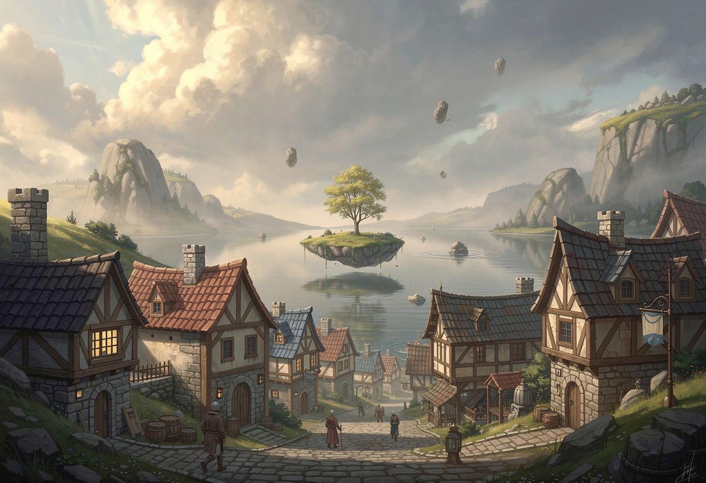

# Longitimuss et Cormor

## Sur la route

<time datime="264-05-28">28 de la Cinquième Lune, 264 <abbr title="Âge des Arcanes">AA</abbr></time>

Après s'être débarrassé des créatures végétales dans le bosquet, le groupe repart et retrouve le chemin. Tandis qu'ils marchent, de grandes discussions s'engagent sur la magie, la nature et le vivant. La journée s'écoule sans histoire, jusqu'à ce qu'ils trouvent un petit endroit pour manger et dormir dans les plaines. [Alzum](../joueurs/alzum/alzum.md) fait étalage de ses talents de survivaliste: il déniche abri et nourriture dans la nature sauvage avec une aisance déconcertante malgré un terrain dont il n'est pas habitué.

Le lendemain matin, les héros repartent… mais [Miyara](../joueurs/miyara/miyara.md) remarque que le poil de Rikka est devenu plus grisâtre — une apparence qui ne restera que le temps d'une journée.

## L'arrivée à Acerflot

<time datime="264-06-05">5 de la Sixième Lune, 264 <abbr title="Âge des Arcanes">AA</abbr></time>

Après plusieurs jours de marche, le groupe arrive à [Acerflot](../lieux/verteris/altera/acerflot/acerflot.md), dernier village avant [La Celtane](../lieux/verteris/altera/celtane/celtane.md). Le spectacle qui s'offre à eux est des plus singuliers: une île céleste flotte au milieu d'un lac, portant sur son dos de pierre un grand érable.

[Corvenna](../joueurs/corvenna/corvenna.md) en profite pour acheter un egnaro, un gros fruit de la taille d'une pastèque, mais à l'apparence d'une orange,. Cette dernière l'emporte avec dans une des auberge du village: la Courge d'Argent.

Des potagers de courges naissantes ornent son extérieur. En entrant, le groupe doit se faufiler sous le bas plafond entre une nuée de chats qui paresse sur les marches et les bancs. Une chevelure grise sautille derrière le bar central, autour duquel s'organisent les trois étages et le sous-sol de l'auberge. Il s'agit de Trista, la tenancière: une halfeline d'une cinquantaine d'années au visage rond et aux joues roses. Ses lunettes en demi-lune glissent sur son nez alors qu'elle salue le groupe avec dynamisme. 

Installés à une table, les héros savourent un thé. Au loin, un voyageur est assis, entouré de papiers et de livres, visiblement plongé dans ses recherches. [Lorquéna](../npcs/lorquena/lorquena.md) semble le connaître: il s'agit de [Longitimuss](../npcs/longitimuss/longitimuss.md), récent assistant du dimensiologue Orvalinus. Le groupe, intéressé, pose quelques questions avant de planifier leur après midi.

## L'érable du lac

Ils décident d'aller se rafraîchir au lac — une occasion de se découvrir chacun un peu plus. [Alzum](../joueurs/alzum/alzum.md) se montre réticent à se baigner et se contente de se rincer au rivage; alors que, dans l'eau, [Corvenna](../joueurs/corvenna/corvenna.md) dévoile de fines rayures sur sa peau. Elle explique que celle-ci doit être protégée à cause du vent constant de sa région.

[Nataniel](../joueurs/nataniel/nataniel.md) tente pour sa part d'escalader l'île flottant au-dessus du lac, mais sans succès. Il rentre à la nage, sous l'eau, retenant son souffle pendant une quinzaine de minutes à la grande surprise de tous. Il explique être un Corps Calme, un type de personne de sa région qui s'immerge pour récupérer le sel.

De leur côté, [Miyara](../joueurs/miyara/miyara.md) et Corvenna comparent leurs étoffes de tissus, toutes deux originaires du Yu Feng.

## Cormor et sa troupe

De retour à l'auberge, la quiétude de la soirée est rompue par l'irruption d'une troupe d'explorateurs. Cormor, un colosse dominant la salle du regard, semble le diriger. Ses cheveux courts noirs dessinent la forme d'une crâne creusé d'une concavité. Derrière lui, ses compagnons se dispersent en silence — un homme à l'oreille déchiquetée par une morsure, un autre à la carrure massive tatouée d'ésotérisme, un et deux jeunes garçons aux mines disparates.

Cormor se dirige droit vers la table de [Longitimuss](../npcs/longitimuss/longitimuss.md). Sans un mot, il toise le jeune homme, avant de lui demander de partir d'un ton intimidant. Ses compagnons referment le cercle derrière lui; Longitimuss ne peut que s'exécuter, renversant au passage sa tasse de thé. Les héros lui font signe de venir s'asseoir à leur table, ce qu'il accepte en souriant.

Longitimuss fait connaissance avec le groupe. Il explique être apprenti dimensiologue à [La Celtane](../lieux/verteris/altera/celtane/celtane.md), sous la tutelle du maître Orvalinus. Il est venu à Acerflot pour étudier l'érable au centre du lac. Il repart après-demain pour La Celtane et serait ravi de faire le chemin avec eux.

Mais Cormor n'en a pas fini. Il revient vers Longitimuss, un air mauvais aux lèvres: un de ses collègues a taché sa manche dans le thé renversé — il demande une tournée pour compenser. [Nataniel](../joueurs/nataniel/nataniel.md) joue sur le sarcasame, alors que [Shin](../joueurs/shin/shin.md) intervient plus frontalement.

> Tu veux quoi, le piaf?
> ─ Cormor, à [Shin](../joueurs/shin/shin.md)

[Alzum](../joueurs/alzum/alzum.md) se lève et confronte Cormor, suivi du reste du groupe qui intervient à tour de rôle. La tension monte entre les deux groupes. Celui de Cormor a la supériorité numérique et semble entraîné. L'un des membres, une femme aux doigts bagués, prend la parole: d'une persuasion doucereuse, elle arrache à Longitimuss une pièce d'argent, avant de ramener sa troupe à sa table. Le groupe se rassoit, les mâchoires serrées.

La soirée se termine à l'auberge, ponctuée de regards mauvais échangés avec leurs rivaux. Trista offre finalement les bières, remerciant les héros de ne pas avoir fait escalader la situation.